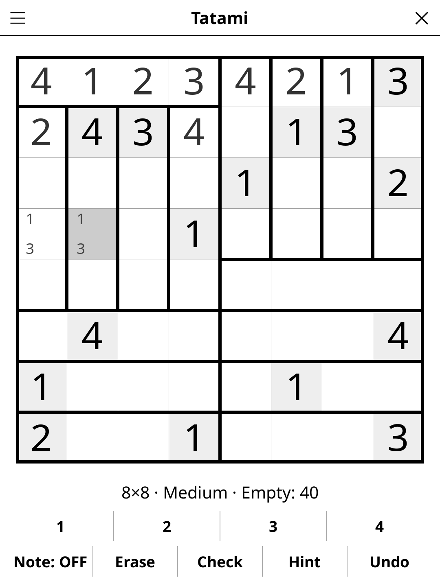

# tatami.koplugin

A Tatami number puzzle plugin for [KOReader](https://github.com/koreader/koreader).

## Screenshot

## Rules

The grid is divided into straight mats, each one cell wide and N cells long
(N = 3 on 6×6 and 9×9, N = 4 on 8×8). Fill every cell with a digit from 1 to N
so that:

1. each mat contains every digit from 1 to N exactly once;
2. each row and each column contains every digit the same number of times
   (twice on 6×6 and 8×8, three times on 9×9);
3. two cells that touch by a side never hold the same digit.

Some digits are given. Every puzzle has exactly one solution, and it can be
found by reasoning alone, without guessing.

### Règles (français)

La grille est découpée en tatamis droits, larges d'une case et longs de N
cases (N = 3 en 6×6 et 9×9, N = 4 en 8×8). Remplissez chaque case avec un
chiffre de 1 à N de sorte que :

1. chaque tatami contienne une fois chaque chiffre de 1 à N ;
2. chaque ligne et chaque colonne contienne chaque chiffre le même nombre de
   fois (deux fois en 6×6 et 8×8, trois fois en 9×9) ;
3. deux cases qui se touchent par un côté ne contiennent jamais le même
   chiffre.

Quelques chiffres sont donnés. Chaque grille a une seule solution, que l'on
trouve par le raisonnement seul, sans deviner.

## Features

- **Three grid sizes** — 6×6 (digits 1–3), 8×8 (digits 1–4), 9×9 (digits 1–3)
- **Three difficulty levels** — Easy needs only the basic deductions (a
  cell with one digit left, a digit with one place left in a mat, a row or
  column whose last copies of a digit have just enough room); Medium also
  needs a little counting across a line (every mat crossing a row puts
  exactly one of each digit somewhere, so the mats lying in the row can
  already use up a digit's quota); Hard shows fewer digits and needs more of
  that counting. No level ever needs trial and error
- **Daily Challenge** — the same puzzle for everyone on a given day
- **Notes** — pencil marks for the digits a cell can still take
- **Check** — shades the cells that differ from the solution
- **Hint** — two taps: the first says which cell is about to give, the second
  fills it in. A wrong cell is always reported before a fresh one is revealed
- **Auto-save** — puzzle state saved and restored on next launch

## Installation

1. Download `tatami.koplugin.zip` from the [latest release](../../releases/latest).
2. Extract into the `plugins/` folder of your KOReader data directory.
3. Restart KOReader.
4. Open the menu → **Tools** → **Games** → **Tatami**.

## Controls

| Action | How |
|--------|-----|
| Select a cell | Tap it |
| Enter a digit | Tap the digit button (tap it again to clear the cell) |
| Pencil marks | Turn **Note** on, then tap digits |
| Erase a cell | Tap **Erase**, or long-press the cell |
| Check progress | Tap **Check** |
| Get a hint | Tap **Hint** (twice to fill the cell) |
| Undo | Tap **Undo** |
| Size, difficulty, Daily Challenge, Reveal, Rules | ☰ menu |

## License

GPL-3.0 — see [LICENSE](LICENSE).
